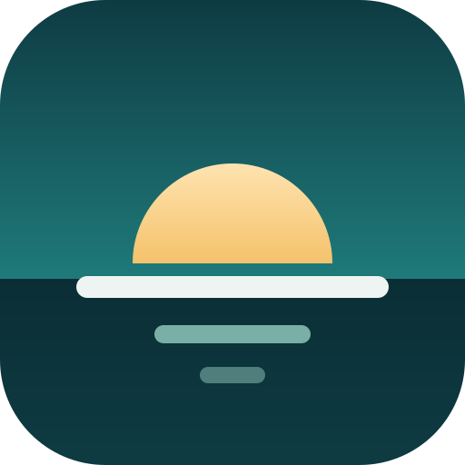

<p align="center">
  
</p>

<h1 align="center">yonder</h1>

<p align="center"><b>Look up. Look far. Get back to it.</b><br/>
A tiny, open-source break reminder for Windows, macOS and Linux.<br/>
<sub>A free alternative to LookAway, Stretchly, Time Out and BreakTimer.</sub></p>

<p align="center">
  
</p>

---

Every 20 minutes, look at something 20 feet away for 20 seconds. Yonder turns that habit into something
you don't have to think about: it lives in your tray, gives you a heads-up before each break, blurs your
desktop into a calm break screen, and stays out of the way while you're in a call, presenting or gaming.

## Features

- **Smart breaks.** Balanced (20 min / 20 s), Deep Focus, Eye Care and Wellness presets, or your own timing, with optional long breaks.
- **Break screens you'll like.** Blurred desktop, split-screen (your desktop parts to reveal a texture), animated Aurora / Nebula / Ripple, gradients or your own image. Rolling countdown and your own messages.
- **Your own sounds.** Ten built-in synthesized sounds, or add any MP3, WAV, OGG or M4A file and use it for breaks or for each reminder.
- **Heads-up, never a surprise.** A frosted heads-up card before each break (start now, +1m, +5m, +15m), and a countdown that follows your cursor for the last five seconds.
- **Waits for the right moment.** Won't start while you type; pauses for meetings, fullscreen apps and the focus apps you choose; time away from the computer counts as a break.
- **Posture & blink reminders.** Small liquid-glass widgets that appear, animate and disappear. Up to five custom reminders with their own icon, interval and sound.
- **Skip difficulty.** Casual, Balanced or Hardcore.
- **Office hours & planned breaks.** Only remind during work hours; schedule lunch or a walk.
- **Shortcuts & automation.** Global hotkeys and shell hooks on break start/end (`YONDER_EVENT`, `YONDER_BREAK_KIND`, `YONDER_BREAK_SECS`).
- **Languages.** English, Português, Español, Français and Deutsch, following your system language or picked in Settings → General. [Add yours](CONTRIBUTING.md#adding-a-translation).
- **Private by design.** No account, no telemetry. Settings and stats stay on your machine; the only network request is an optional update check against GitHub Releases (toggle in Settings → About).
- **Update notifications.** A tray entry and a banner in Settings when a new version is out, with Homebrew instructions on macOS. Skip a version or turn checks off anytime.
- **Lightweight.** Rust core + the system webview (Tauri 2). A few MB to download, near-zero CPU between breaks; windows only exist while they're on screen.

<table>
  <tr>
    <td width="50%"><br/><sub><b>Posture &amp; blink reminders</b> appear, animate and get out of the way.</sub></td>
    <td width="50%"><br/><sub><b>Split-screen breaks</b> part your desktop to reveal a texture.</sub></td>
  </tr>
  <tr>
    <td colspan="2"><br/><sub><b>Settings</b> in light or dark, laid out like your system's own.</sub></td>
  </tr>
</table>

<sub>Teasers are recorded from the app's real UI pages (MP4 versions in <a href="media/">media/</a>).</sub>

## Install

**macOS** (Homebrew, no App Store needed):

```sh
brew tap rmoura98/yonder https://github.com/RMoura98/yonder
brew install --cask yonder
```

Update with `brew upgrade --cask yonder`. Yonder isn't notarized yet, so the cask clears the macOS quarantine flag after
installing; if you download the `.dmg` yourself instead, right-click Yonder.app → **Open** the first time.

**Windows:** download the `.exe` (or `.msi`) installer from the [latest release](https://github.com/RMoura98/yonder/releases/latest).
SmartScreen may warn about an unrecognized app: choose **More info → Run anyway**.

**Linux:** grab the `.AppImage`, `.deb` or `.rpm` from the [latest release](https://github.com/RMoura98/yonder/releases/latest).

**Stay up to date:** follow the [releases feed](https://github.com/RMoura98/yonder/releases.atom) in any RSS reader (no account
needed), or click **Watch → Custom → Releases** on this repo. News and questions live in [Discussions](https://github.com/RMoura98/yonder/discussions).

## Yonder vs. LookAway

[LookAway](https://lookaway.com) is a polished, paid break reminder for the Mac, and it inspired a lot of
Yonder's feel. If you're on a recent Mac, want iPhone sync and deep macOS integration, and are happy to pay,
it's a great choice. Yonder is for everyone else: **every desktop, older Macs, free, and open to change.**

| | Yonder | LookAway |
|---|---|---|
| Price | **Free** | Paid, one-time license (from $19) |
| Source | **Open source (MIT)**: change anything, down to the UI | Closed source |
| Windows | **Yes** (10, 11) | Announced as coming soon |
| Linux | **Yes** (.AppImage, .deb, .rpm) | No |
| macOS | **10.15 Catalina and newer** | 13 Ventura and newer |
| Split-screen break | Windows and macOS 10.15+ | macOS 26 Tahoe and newer |
| Your own sounds, images, gradients, messages | Yes | Yes |
| Custom reminders | Up to 5 | Up to 5 |
| Automation | Shell commands on break start/end, on every OS; global hotkeys | Shortcuts, AppleScript, Siri, Focus Filters |
| Smart pause on macOS | Zoom meetings and apps you choose | Camera/mic meetings, video, fullscreen, screen recording |
| Stats | Screen time, breaks, daily history, JSON export | Includes app and website usage |
| iPhone / iPad companion | No | Yes |
| Signed & notarized | Not yet ([#6](https://github.com/RMoura98/yonder/issues/6)) | Yes |

Comparison based on lookaway.com as of November 2026; corrections welcome. Yonder is an independent project, not affiliated
with or endorsed by LookAway or Mystical Bits; product names belong to their owners.

## Platform notes

| Feature | Windows | macOS | Linux |
|---|---|---|---|
| Breaks, reminders, stats, shortcuts | ✓ | ✓ | ✓ |
| Blurred desktop & split-screen | ✓ | ✓ (needs Screen Recording permission) | — |
| Meeting detection | mic/camera in use | Zoom meeting helper | mic recording (PulseAudio/PipeWire) |
| Fullscreen detection | ✓ | — | — |
| Focus apps (by process name) | ✓ | ✓ | ✓ |
| Countdown next to tray icon | — (tooltip) | ✓ | panel-dependent |

## Build from source

Prerequisites: [Rust](https://rustup.rs), Node 20+, and the [Tauri prerequisites](https://tauri.app/start/prerequisites/) for your OS.

```sh
git clone https://github.com/RMoura98/yonder
cd yonder/app
npm install
npm run tauri dev      # run
npm run tauri build    # installers in src-tauri/target/release/bundle/
```

Pushing a `v*` tag runs `.github/workflows/release.yml`, which builds Windows (.exe/.msi), macOS (universal .dmg)
and Linux (.AppImage/.deb/.rpm) installers into a draft release.

## Repository layout

```
app/            Tauri app
  src/          UI: settings, break screen, heads-up, reminders (plain HTML/CSS/JS, no build step)
  src-tauri/    Rust core: scheduler, idle & smart-pause detection, tray, windows
website/        Static marketing + docs site (GitHub Pages)
brand/          Logo files
```

## Support

Yonder is free forever. If it helps you, you can [sponsor its development](https://github.com/sponsors/RMoura98) ♥

## Contributors

Thanks to everyone who has helped make Yonder better. Issues and pull requests are welcome.

<a href="https://github.com/RMoura98/yonder/graphs/contributors">
  
</a>

## Star history

<a href="https://star-history.com/#RMoura98/yonder&Date">
  <picture>
    <source media="(prefers-color-scheme: dark)" srcset="https://api.star-history.com/svg?repos=RMoura98/yonder&type=Date&theme=dark" />
    <source media="(prefers-color-scheme: light)" srcset="https://api.star-history.com/svg?repos=RMoura98/yonder&type=Date" />
    
  </picture>
</a>

## License

[MIT](LICENSE). Icons: [Material Symbols](https://fonts.google.com/icons) (Apache 2.0).
