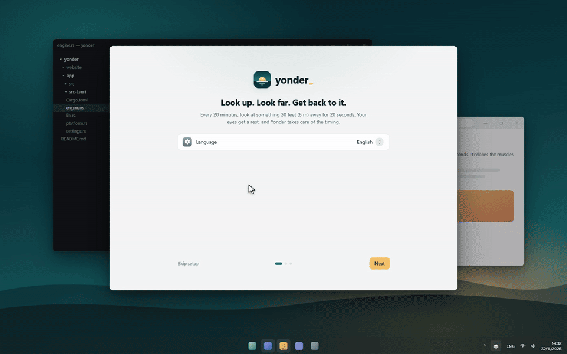
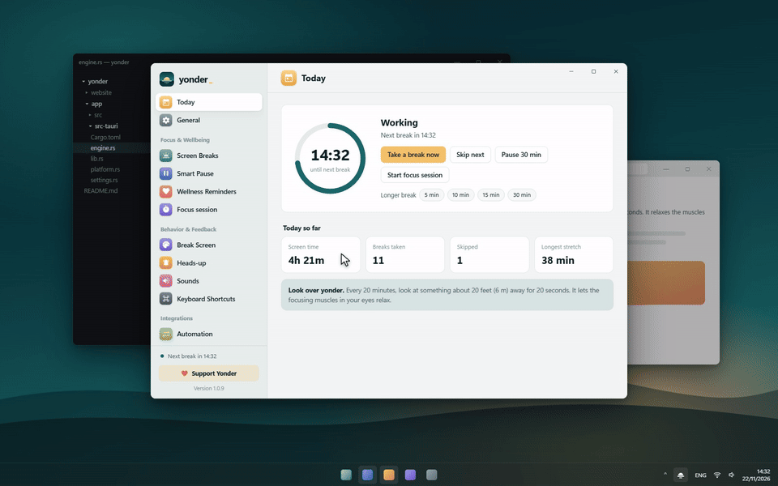
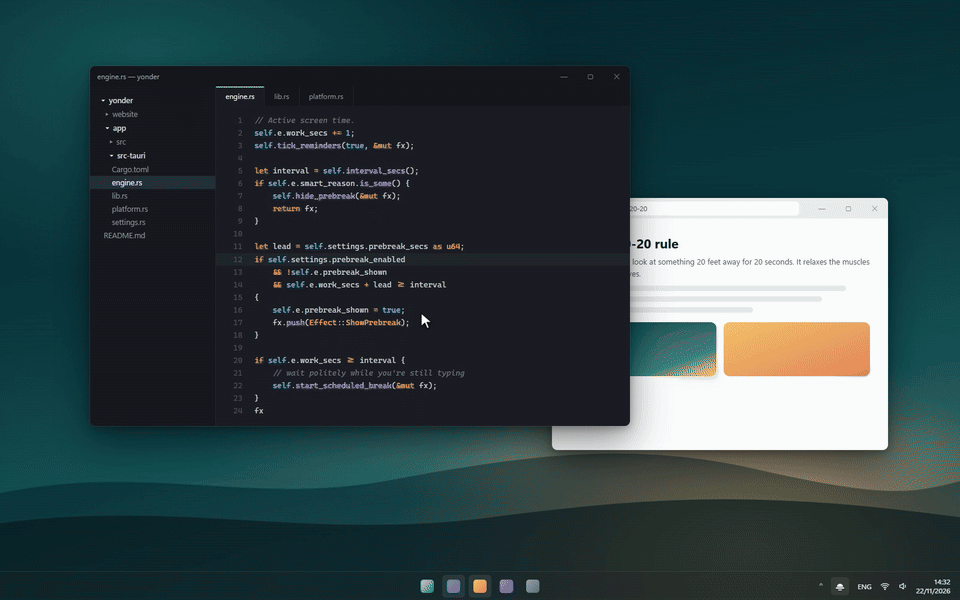
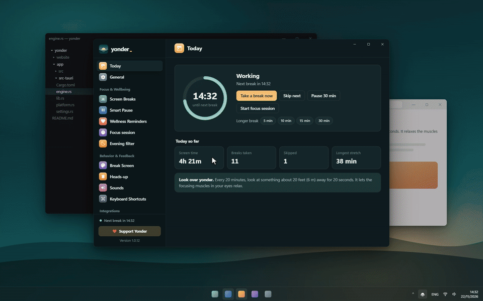
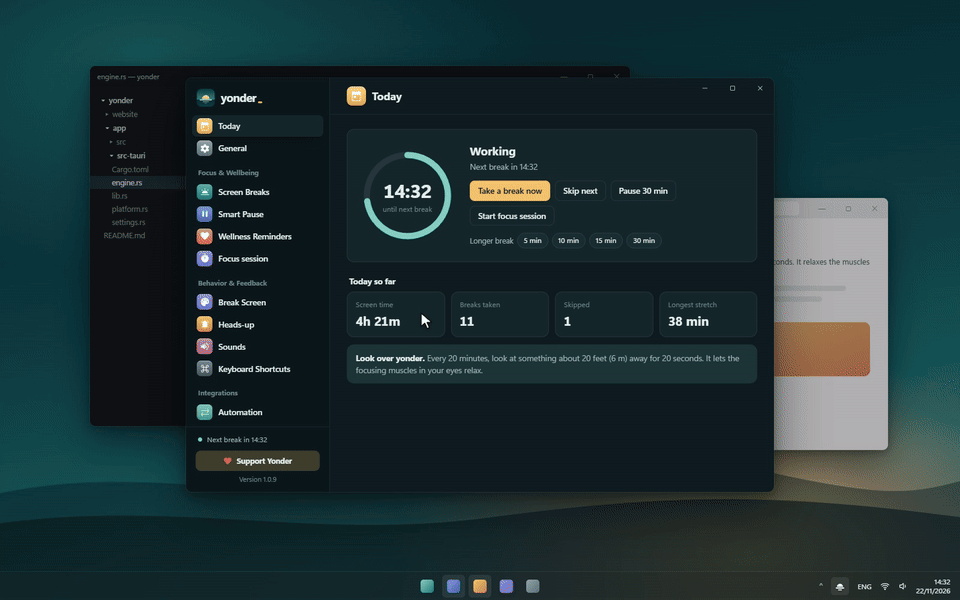

<p align="center">
  
</p>

<h1 align="center">yonder</h1>

<p align="center"><b>Look up. Look far. Get back to it.</b><br/>
A tiny, open-source break reminder for Windows, macOS and Linux.<br/>
<sub>A free alternative to LookAway, Stretchly, Time Out and BreakTimer.</sub></p>

<p align="center">
  
</p>

---

Every 20 minutes, look at something 20 feet away for 20 seconds. Yonder turns that habit into something
you don't have to think about: it lives in your tray, gives you a heads-up before each break, blurs your
desktop into a calm break screen, and stays out of the way while you're in a call, presenting or gaming.

## Features

- **Smart breaks.** Balanced (20 min / 20 s), Deep Focus, Eye Care and Wellness presets, or your own timing, with optional long breaks.
- **Break screens you'll like.** Blurred desktop (edge to edge, even over a borderless game), split-screen (your desktop parts to reveal a texture), animated Aurora / Nebula / Ripple, gradients or your own image, **Gentle** (the screen just dims and clicks pass through, so a call or a game keeps going), or **Notification only** (a desktop notification and a chime, no window). Rolling countdown and your own messages.
- **Guided exercises (optional).** Long breaks can walk you through a calm routine sized to the break: slow blinks, a dot to follow, near and far focus, neck and shoulder stretches, palming. Off by default, respects reduced motion. Exercise ideas from Workrave and Safe Eyes.
- **Your own sounds.** Fifteen built-in synthesized sounds, or add any MP3, WAV, OGG or M4A file and use it for breaks or for each reminder.
- **Heads-up, never a surprise.** A small "Break in 0:54" next to your cursor before each break (it never takes the keyboard), or the frosted heads-up card with start now, +1m, +5m and +15m; the last five seconds always count down next to the cursor.
- **Waits for the right moment.** Won't start while you type; pauses for calls, screen sharing and recording, fullscreen apps, Do Not Disturb / Focus and the focus apps you choose, but never holds a break for more than an hour (you pick the limit); time away from the computer counts as a break. For games and other fullscreen apps you choose: wait, a quiet notification instead, show the break anyway, or skip it.
- **Tray popover.** Click the tray icon for a small card with a live countdown ring, today's screen time, breaks and score, and quick actions (take a break, pause, skip, settings). Double-click opens Settings. Right-click keeps the classic menu; on Linux, where many panels don't report tray clicks, the menu has a *Show status* entry instead.
- **Evening filter (optional).** Warms and dims your screen on a schedule (say 21:00 to 07:00), fading in and out over half an hour, with your own colour temperature and dimming. Off by default; your screen is always restored when Yonder quits. Windows, macOS and Linux on X11.
- **Countdown in the tray.** On Windows, optionally draw the minutes left right into the tray icon; on macOS and some Linux panels the countdown sits next to the icon (or hide it for an icon-only tray).
- **Pauses your music.** Optionally pauses music and video when a break starts and resumes only what it paused (system media controls on Windows, Music/Spotify on macOS, playerctl on Linux).
- **Set up in three steps.** The first time you open Yonder: language, rhythm and break style (on macOS, plus Screen Recording when your break look needs it). Skip it if you like.
- **Posture & blink reminders.** Small liquid-glass widgets that appear, animate and disappear. Up to five custom reminders with their own icon, interval and sound.
- **Focus sessions.** An optional Pomodoro mode (25 min focus, 5 min break, a long break after the fourth period, all adjustable) started from the tray or the Today page. It runs alongside your eye breaks and merges the two: an eye break that would land within a few minutes of a focus break is folded into it, so you are never interrupted twice in a row.
- **Stats that motivate.** Today, this week vs last week, current and best streaks, a year heatmap of the days you took your breaks, and export to CSV, Markdown or JSON.
- **Skip difficulty.** Casual, Balanced, Firm (hold Skip for 2 seconds) or Hardcore.
- **Office hours & planned breaks.** Only remind during work hours; schedule lunch or a walk.
- **Shortcuts & automation.** Global hotkeys, shell hooks on break start/end (`YONDER_EVENT`, `YONDER_BREAK_KIND`, `YONDER_BREAK_SECS`), and scripting with `yonder://` links or command-line options (`yonder --pause 30`, `yonder://break`, `--focus 25`…) from Shortcuts, AutoHotkey, cron or a Stream Deck.
- **Languages.** English, Português, Español, Français, Deutsch, 简体中文 and 日本語, following your system language or picked in Settings → General. [Add yours](CONTRIBUTING.md#adding-a-translation).
- **Remembers your countdown.** Restart Yonder (an update, a crash) within ten minutes and the countdown carries on; longer than that counts as a break.
- **Logs when you need them.** A small rotating log (about 1 MB) with an *Open logs folder* button and an optional detailed mode, so bug reports come with evidence. It never records what you type or see.
- **Back up your settings.** Export everything (settings, custom sounds, break background) to one file from Settings → About and import it on another computer.
- **Private by design.** No account, no telemetry. Settings and stats stay on your machine; the only network request is an optional update check against GitHub Releases (toggle in Settings → About).
- **Update notifications.** A tray entry and a banner in Settings when a new version is out, with Homebrew instructions on macOS. Skip a version or turn checks off anytime.
- **Multiple monitors.** Every screen gets its own break overlay with its own blurred desktop, monitors plugged in or out mid-break are handled, and the heads-up shows up on the screen you're using, even with mixed display scaling.
- **Lightweight.** Rust core + the system webview (Tauri 2). A few MB to download, near-zero CPU between breaks; windows only exist while they're on screen.

<table>
  <tr>
    <td width="50%"><br/><sub><b>Posture &amp; blink reminders</b> appear, animate and get out of the way.</sub></td>
    <td width="50%"><br/><sub><b>Split-screen breaks</b> part your desktop to reveal a texture.</sub></td>
  </tr>
  <tr>
    <td width="50%"><br/><sub><b>Gentle breaks</b> dim the screen and let clicks through.</sub></td>
    <td width="50%"><br/><sub><b>First-run setup</b> in three steps.</sub></td>
  </tr>
  <tr>
    <td width="50%"><br/><sub><b>Tray popover</b>: your countdown and today's score, one click away.</sub></td>
    <td width="50%"><br/><sub><b>Focus sessions</b>: Pomodoro that merges with your eye breaks.</sub></td>
  </tr>
  <tr>
    <td colspan="2"><br/><sub><b>Guided exercises</b> (optional) during long breaks: blink, follow the dot, near and far, stretches.</sub></td>
  </tr>
  <tr>
    <td colspan="2"><br/><sub><b>Evening filter</b> (optional): a warmer, dimmer screen on your schedule.</sub></td>
  </tr>
  <tr>
    <td colspan="2"><br/><sub><b>Stats</b>: weekly summary, streaks, a year heatmap and CSV / Markdown export.</sub></td>
  </tr>
  <tr>
    <td colspan="2"><br/><sub><b>Settings</b> in light or dark, laid out like your system's own.</sub></td>
  </tr>
</table>

<sub>Teasers are recorded from the app's real UI pages (MP4 versions in <a href="media/">media/</a>).</sub>

## Install

**macOS** (Homebrew, no App Store needed):

```sh
brew install --cask rmoura98/tap/yonder
```

Update with `brew upgrade --cask yonder`. Yonder isn't notarized yet, so the cask clears the macOS quarantine flag after
installing; if you download the `.dmg` yourself instead, right-click Yonder.app → **Open** the first time.
(Installed with the older `brew tap rmoura98/yonder …` command? That keeps working too.)

**Windows:** with [Scoop](https://scoop.sh):

```powershell
scoop bucket add yonder https://github.com/RMoura98/scoop-bucket
scoop install yonder/yonder
```

or download the `.exe` (or `.msi`) installer from the [latest release](https://github.com/RMoura98/yonder/releases/latest).
Prefer not to install anything? The `x64-portable.zip` holds a single `yonder.exe` you can run from any folder
(settings still live in your user profile). SmartScreen may warn about an unrecognized app: choose **More info → Run anyway**.

**Linux (Debian, Ubuntu and derivatives):** add the signed apt repository once, then updates come with `apt upgrade`:

```sh
curl -fsSL https://rmoura98.github.io/yonder/apt/yonder.gpg | sudo tee /usr/share/keyrings/yonder.gpg > /dev/null
echo "deb [signed-by=/usr/share/keyrings/yonder.gpg] https://rmoura98.github.io/yonder/apt stable main" | sudo tee /etc/apt/sources.list.d/yonder.list
sudo apt update && sudo apt install yonder
```

**Other Linux:** grab the `.AppImage`, `.deb` or `.rpm` from the [latest release](https://github.com/RMoura98/yonder/releases/latest).

**Verify a download:** every release has a `SHA256SUMS.txt`. Put it next to the file you downloaded and run
`sha256sum -c --ignore-missing SHA256SUMS.txt` (Linux), `shasum -a 256 -c --ignore-missing SHA256SUMS.txt` (macOS), or on Windows
compare `(Get-FileHash .\Yonder_*_x64-setup.exe).Hash` with the matching line.

**Stay up to date:** follow the [releases feed](https://github.com/RMoura98/yonder/releases.atom) in any RSS reader (no account
needed), or click **Watch → Custom → Releases** on this repo. News and questions live in [Discussions](https://github.com/RMoura98/yonder/discussions).

## Yonder vs. LookAway

[LookAway](https://lookaway.com) is a polished, paid break reminder for the Mac, and it inspired a lot of
Yonder's feel. If you're on a recent Mac, want iPhone sync and deep macOS integration, and are happy to pay,
it's a great choice. Yonder is for everyone else: **every desktop, older Macs, free, and open to change.**

| | Yonder | LookAway |
|---|---|---|
| Price | **Free** | Paid, one-time license (from $19) |
| Source | **Open source (MIT)**: change anything, down to the UI | Closed source |
| Windows | **Yes** (10, 11) | Announced as coming soon |
| Linux | **Yes** (.AppImage, .deb, .rpm) | No |
| macOS | **10.15 Catalina and newer** | 13 Ventura and newer |
| Split-screen break | Windows, macOS 10.15+ and Linux | macOS 26 Tahoe and newer |
| Your own sounds, images, gradients, messages | Yes | Yes |
| Custom reminders | Up to 5 | Up to 5 |
| Automation | `yonder://` links and command-line options, shell commands on break start/end, global hotkeys, on every OS | Shortcuts, AppleScript, Siri, Focus Filters |
| Smart pause on macOS | Mic/camera in use (CoreAudio, CoreMediaIO), fullscreen, mirrored displays, known screen recorders and apps you choose | Camera/mic meetings, video, fullscreen, screen recording |
| Stats | Screen time, breaks, weekly summary, streaks, year heatmap, CSV / Markdown / JSON export | Includes app and website usage |
| iPhone / iPad companion | No | Yes |
| Signed & notarized | Not yet ([#6](https://github.com/RMoura98/yonder/issues/6)) | Yes |

Comparison based on lookaway.com as of November 2026; corrections welcome. Yonder is an independent project, not affiliated
with or endorsed by LookAway or Mystical Bits; product names belong to their owners.

## A note on health

Yonder helps you build a habit: regular look-away breaks, blinking and posture checks are widely recommended for
eye comfort and can ease the tired, dry-eyed feeling of long screen days. It doesn't diagnose anything, treat eye
conditions or improve your eyesight, and it's no substitute for an eye exam. If your eyes hurt or your vision changes,
see an optometrist or ophthalmologist.

## Platform notes

| Feature | Windows | macOS | Linux |
|---|---|---|---|
| Breaks, reminders, stats, shortcuts | ✓ | ✓ | ✓ |
| Blurred desktop & split-screen | ✓ | ✓ (needs Screen Recording permission) | X11; GNOME and KDE on Wayland (through the screenshot portal, may ask once); Sway/Hyprland with `grim` |
| Evening filter (warm & dim) | ✓ | ✓ | X11 (on Wayland use GNOME Night Light or KDE Night Color) |
| Meeting detection | mic/camera in use | mic/camera in use (any app, no permission prompt) + Zoom meeting helper | mic recording (PulseAudio/PipeWire) |
| Screen sharing & recording | known recorders (OBS...), mirrored display | known recorders (OBS...), mirrored display | known recorders, PipeWire screencast |
| Fullscreen detection | ✓ | ✓ | — |
| Do Not Disturb / Focus | ✓ | best effort (needs Full Disk Access) | GNOME, KDE |
| Focus apps (by process name) | ✓ | ✓ | ✓ |
| Idle detection (away counts as a break) | ✓ | ✓ | X11 (`xprintidle`); on Wayland GNOME, KDE Plasma, and Sway, Hyprland, river, Wayfire and niri (`ext-idle-notify`) |
| Countdown next to tray icon | — (tooltip) | ✓ | panel-dependent |

## Build from source

Prerequisites: [Rust](https://rustup.rs), Node 20+, and the [Tauri prerequisites](https://tauri.app/start/prerequisites/) for your OS.

```sh
git clone https://github.com/RMoura98/yonder
cd yonder/app
npm install
npm run tauri dev      # run
npm run tauri build    # installers in src-tauri/target/release/bundle/
```

Pushing a `v*` tag runs `.github/workflows/release.yml`, which builds Windows (.exe/.msi), macOS (universal .dmg)
and Linux (.AppImage/.deb/.rpm) installers into a draft release.

## Repository layout

```
app/            Tauri app
  src/          UI: settings, break screen, heads-up, reminders (plain HTML/CSS/JS, no build step)
  src-tauri/    Rust core: scheduler, idle & smart-pause detection, tray, windows
website/        Static marketing + docs site (GitHub Pages)
brand/          Logo files
```

## Support

Yonder is free forever. If it helps you, you can [sponsor its development](https://github.com/sponsors/RMoura98) ♥

## Contributors

Thanks to everyone who has helped make Yonder better. Issues and pull requests are welcome.

<a href="https://github.com/RMoura98/yonder/graphs/contributors">
  
</a>

## Star history

<a href="https://star-history.com/#RMoura98/yonder&Date">
  <picture>
    <source media="(prefers-color-scheme: dark)" srcset="https://api.star-history.com/svg?repos=RMoura98/yonder&type=Date&theme=dark" />
    <source media="(prefers-color-scheme: light)" srcset="https://api.star-history.com/svg?repos=RMoura98/yonder&type=Date" />
    
  </picture>
</a>

## Code signing policy

Free code signing provided by [SignPath.io](https://about.signpath.io), certificate by [SignPath Foundation](https://signpath.org).
Who signs what, the team roles and the privacy policy are in [CODE_SIGNING.md](CODE_SIGNING.md).

## License

[MIT](LICENSE). Icons: [Material Symbols](https://fonts.google.com/icons) (Apache 2.0).
